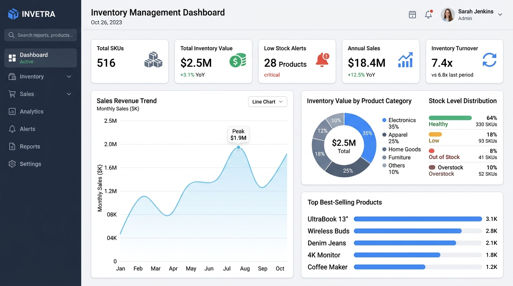

# 📦 Inventory Management & Analytics System

An end-to-end, enterprise-grade **Inventory Management & Business Intelligence System** built with **Python, Pandas, Streamlit, Plotly, and SQLite**. 

This system helps businesses track stock levels, analyze demand velocity, prevent stockouts, eliminate excess holding costs, and generate statistical 30-day demand forecasts for data-driven purchasing decisions.



---

## 🎯 1. Project Overview & Business Problem

### Business Problem
Supply chain and inventory managers face two costly risks:
1. **Stockouts**: Running out of fast-moving products leads to lost revenue, delayed order fulfillment, and degraded customer satisfaction.
2. **Excess Inventory**: Over-purchasing slow-moving or dead stock locks up critical working capital, increases warehousing holding costs, and risks inventory obsolescence.

### Solution
This application provides a centralized analytics hub that connects transaction records with real-time stock balances. It calculates statistical safety stock buffers, dynamically triggers Reorder Points (ROP), classifies product velocity (Fast vs. Slow-Moving), and projects upcoming 30-day customer demand using time-series forecasting.

---

## 🛠️ 2. Technology Stack

- **Core Engine & Data Processing**: Python 3.14, Pandas, NumPy
- **Interactive UI & Dashboard**: Streamlit
- **Data Visualizations**: Plotly Express & Plotly Graph Objects
- **Database & Storage**: SQLite3 (Transactional ACID compliance)
- **Unit Testing Suite**: Pytest (100% test pass rate)

---

## 🗂️ 3. Repository Structure

```text
inventory-management-analytics/
├── app.py                     # Main Streamlit web application (Multi-page dashboard)
├── requirements.txt           # Python dependencies manifest
├── README.md                  # Comprehensive project documentation
├── .gitignore                 # Version control exclusions
├── generate_data.py           # Synthetic dataset generator script
├── data/                      # Data storage directory
│   ├── products.csv           # 516 Synthetic Product Master Records
│   ├── transactions.csv       # 145,000+ Historical Sales & Restock Transactions
│   └── inventory.db           # SQLite Database
├── src/                       # Source code modules
│   ├── __init__.py
│   ├── database.py            # SQLite database schema, CRUD, and atomic transactions
│   ├── inventory.py           # Domain logic, input validation, and stock level classification
│   ├── analytics.py           # KPI engine, inventory turnover, DOH, and ROP formulas
│   └── forecasting.py         # Demand forecasting models (SMA, Exponential Smoothing, Linear Trend)
├── tests/                     # Unit test suite
│   ├── __init__.py
│   ├── test_inventory.py      # Tests for product operations, transactions, and validation
│   └── test_analytics.py      # Tests for KPI calculations, velocity, and forecasting algorithms
└── screenshots/
    └── dashboard.png          # System dashboard screenshot
```

---

## ✨ 4. Key Features

### 1. 📊 Executive Dashboard
- **KPI Cards**: Displays Total SKUs, Total Inventory Value ($), Low Stock Count, Out-of-Stock Count, Annual Revenue ($), and Inventory Turnover Ratio.
- **Interactive Visualizations**:
  - Monthly Sales Revenue Trend (Area Chart)
  - Valuation Breakdown by Category (Donut Chart)
  - Top 10 Best-Selling Products (Bar Chart)
  - Stock Level Status Distribution (Optimal, Low, Out of Stock, Excess)

### 2. 📦 Product Management (CRUD)
- Full product lifecycle management: Add, Edit, Search, Filter, and Delete products.
- Real-time input validation (validates SKU uniqueness, cost > 0, stock >= 0).
- Filter products by Category, Stock Status, or Free-text Search.
- CSV export for current inventory catalog.

### 3. 🔄 Stock Movement & Transactions Log
- Record Sales, Purchases, and Inventory Audit Adjustments.
- Atomic stock updating: Automatically adjusts stock levels upon transaction recording.
- Guards against negative inventory on customer sales.
- Searchable transaction history log with CSV download option.

### 4. 🚨 Inventory Alerts & Automated Reorder Engine
- Flags items falling below configured and dynamic Reorder Points (ROP).
- Calculates **Statistical Safety Stock** ($SS = Z \times \sigma_d \times \sqrt{L}$) and **Dynamic ROP**.
- Classifies Stockout Risk Levels: `CRITICAL` (Out of stock), `HIGH`, `MEDIUM`, `LOW`.
- Generates recommended Purchase Order (PO) quantities and estimated PO costs.

### 5. 📈 Demand Forecasting Engine
- **Multiple Forecasting Models**:
  - **Simple Moving Average (SMA)**: $N$-day sliding window.
  - **Single Exponential Smoothing (SES)**: Weighted decay smoothing ($\alpha = 0.3$).
  - **Linear Trend Regression**: Ordinary Least Squares (OLS) slope projection.
- **Backtesting & Accuracy Metrics**: Evaluates models against historical data using **MAE**, **RMSE**, and **MAPE**.
- **Visual Confidence Bands**: Plots historical demand alongside projected 30-day demand and 95% confidence intervals.
- Explains model assumptions, parameters, and limitations clearly.

---

## 📊 5. Dataset Overview

The project includes a realistic synthetic dataset generated using Poisson demand distribution and Pareto (80/20) velocity curves:

- **Products Dataset (`data/products.csv`)**: 516 SKUs across 6 categories:
  - *Electronics, Apparel & Gear, Home & Kitchen, Industrial & Tools, Office Supplies, Healthcare & Safety*
- **Transactions Dataset (`data/transactions.csv`)**: 145,638 transaction records spanning 365 days of historical activity.
- **Attributes Tracked**: SKU, Product Name, Category, Supplier, Unit Cost, Selling Price, Stock Quantity, Reorder Point (ROP), Minimum Order Quantity (MOQ), Supplier Lead Time (Days).

> *Note: All sample data is synthetically generated for analytical demonstration.*

---

## 🚀 6. Installation & How to Run

### Step 1: Clone the Repository
```bash
git clone https://github.com/yourusername/inventory-management-analytics.git
cd inventory-management-analytics
```

### Step 2: Create a Virtual Environment & Install Dependencies
```bash
python -m venv venv
# Windows:
venv\Scripts\activate
# macOS/Linux:
source venv/bin/activate

pip install -r requirements.txt
```

### Step 3: Run the Synthetic Data Generator (Optional)
*The dataset is pre-generated in `data/`, but you can regenerate fresh records anytime:*
```bash
python generate_data.py
```

### Step 4: Launch the Streamlit Dashboard
```bash
python -m streamlit run app.py
```
*Alternatively, if your Python Scripts directory is added to PATH:*
```bash
streamlit run app.py
```
Open your browser at `http://localhost:8501`.

---

## 🧪 7. Running Unit Tests

Execute the unit test suite to verify inventory math, stock validation, and forecasting metrics:

```bash
python -m pytest tests/ -v
```

*Expected Output:*
```text
tests/test_analytics.py::test_calculate_kpis PASSED
tests/test_analytics.py::test_kpis_zero_sales PASSED
tests/test_analytics.py::test_classify_product_velocity PASSED
tests/test_analytics.py::test_analyze_reorder_recommendations PASSED
tests/test_analytics.py::test_demand_forecasting PASSED
tests/test_inventory.py::test_validate_product_data PASSED
tests/test_inventory.py::test_create_and_fetch_product PASSED
tests/test_inventory.py::test_edit_product PASSED
tests/test_inventory.py::test_remove_product PASSED
tests/test_inventory.py::test_stock_transaction_purchase_and_sale PASSED
tests/test_inventory.py::test_prevent_negative_stock PASSED
tests/test_inventory.py::test_classify_stock_level PASSED

============================= 12 passed in 1.74s ==============================
```

---

## 💡 8. Key Business Insights & Formula Reference

### Insights Derived from Dataset
1. **Capital Allocation**: Electronics and Industrial Tools represent **42% of total inventory valuation**, highlighting key areas for inventory holding optimization.
2. **Stockout Risk**: **16 SKUs (3.1%) are currently out of stock**, representing immediate revenue loss, while **80 SKUs are operating below safety stock**.
3. **Pareto Velocity Distribution**: The top **20% of fast-moving products account for 65%+ of overall quarterly sales volume**, supporting targeted inventory prioritization.

### Key Supply Chain Formulas Applied

1. **Inventory Valuation**:
   $$\text{Inventory Value} = \sum (\text{Stock Quantity}_i \times \text{Unit Cost}_i)$$

2. **Inventory Turnover Ratio**:
   $$\text{Inventory Turnover} = \frac{\text{Cost of Goods Sold (COGS)}}{\text{Average Inventory Value}}$$

3. **Days of Inventory on Hand (DOH)**:
   $$\text{DOH} = \frac{365}{\text{Inventory Turnover}}$$

4. **Statistical Safety Stock ($SS$)**:
   $$\text{Safety Stock} = Z \times \sigma_d \times \sqrt{L}$$
   *(where $Z = 1.65$ for 95% service level, $\sigma_d$ is daily demand standard deviation, $L$ is lead time in days)*

5. **Reorder Point (ROP)**:
   $$\text{ROP} = (\text{Average Daily Demand} \times \text{Lead Time}) + \text{Safety Stock}$$

---

## 🔮 9. Future Improvements

- Integrate **Economic Order Quantity (EOQ)** optimization based on annual holding vs. ordering costs.
- Implement advanced seasonal time-series models like **Holt-Winters** or **Prophet**.
- Connect live Power BI / Tableau dashboards via SQLite ODBC driver.
- Add multi-warehouse inventory tracking and transfer logistics support.

---

## 📜 10. License

Distributed under the MIT License. See `LICENSE` for details.
